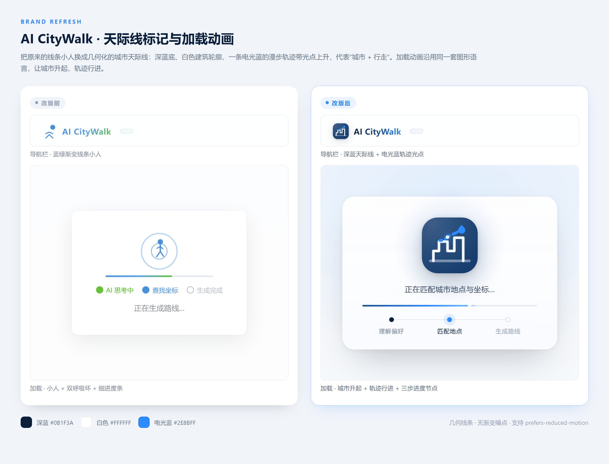

# UI/UX 设计规范

## 1. 设计系统

### 1.1 颜色体系

| 用途 | 颜色值 | 说明 |
|------|--------|------|
| 主色 | `#4A90D9` | 清新蓝，用于按钮、链接、地图折线、标记点 |
| 品牌深蓝 | `#0B1F3A` | 品牌标记底色、导航标题渐变起点 |
| 电光蓝 | `#2E8BFF` | 天际线轨迹、光点、进度条、当前步骤 |
| 辅助色-绿 | `#67C23A` | 生机绿，用于标记点默认状态 |
| 辅助色-橙 | `#E6A23C` | 暖橙，用于高亮、选中状态 |
| 背景色 | `#F7F9FC` | 淡灰白，页面整体背景 |
| 卡片色 | `#FFFFFF` | 纯白，卡片/面板背景 |
| 主文字 | `#303133` | 深灰，标题和正文 |
| 次文字 | `#909399` | 中灰，辅助说明文字 |
| 边框色 | `#E4E7ED` | 浅灰，输入框和分隔线 |
| 成功色 | `#67C23A` | 绿色，成功提示 |
| 错误色 | `#F56C6C` | 红色，错误提示 |

### 1.2 字体

```css
font-family: -apple-system, "PingFang SC", "Microsoft YaHei", "Helvetica Neue", sans-serif;
```

| 用途 | 字号 | 字重 |
|------|------|------|
| 页面标题 | 24px | 600 (semibold) |
| 卡片标题 | 16px | 600 |
| 正文 | 14px | 400 |
| 辅助文字 | 12px | 400 |
| 按钮文字 | 14px | 500 |

### 1.3 间距系统

基于 8px 网格：

| 用途 | 间距 |
|------|------|
| 组件内部间距 | 8px / 12px |
| 卡片内边距 | 16px / 20px |
| 卡片之间间距 | 16px |
| 区块之间间距 | 24px |
| 页面外边距 | 24px / 32px |

### 1.4 圆角

| 用途 | 圆角 |
|------|------|
| 按钮 | 8px |
| 输入框 | 8px |
| 卡片 | 12px |
| 胶囊标签 | 20px（全圆角） |
| 弹窗/遮罩 | 16px |

### 1.5 阴影

| 用途 | 阴影 |
|------|------|
| 卡片 | `0 2px 12px rgba(0, 0, 0, 0.08)` |
| 卡片 hover | `0 4px 16px rgba(0, 0, 0, 0.12)` |
| 弹窗 | `0 8px 24px rgba(0, 0, 0, 0.15)` |
| 导航栏 | `0 1px 4px rgba(0, 0, 0, 0.06)` |

---

## 2. 页面布局

### 2.1 桌面端（>768px）

```
┌─────────────────────────────────────────────────────┐
│  🚶 AI CityWalk                        [📋 历史记录] │  导航栏（60px高）
├────────────────┬────────────────────────────────────┤
│                │                                    │
│  [城市输入框]   │                                    │
│                │         腾讯地图区域                  │
│  [主题风格]     │        （自适应填满剩余空间）         │
│  ○文艺 ○美食   │                                    │
│  ○历史 ○复古   │        标记点 + 折线                 │
│  ○自然 ○潮流   │                                    │
│                │                                    │
│  [时间体力]     │                                    │
│  [预算偏好]     │                                    │
│  [特殊需求]     │                                    │
│                │                                    │
│  [自由描述文本框]│                                    │
│                │                                    │
│  [🚀 生成路线]  │                                    │
│                │                                    │
├────────────────┴────────────────────────────────────┤
│                                                     │
│  路线详情卡片区（生成后显示，flex 横向排列可滚动）       │
│  ┌─────────┐ ┌─────────┐ ┌─────────┐ ┌─────────┐  │
│  │ ① 地点名 │ │ ② 地点名 │ │ ③ 地点名 │ │ ④ 地点名 │  │
│  │ 推荐理由  │ │ 推荐理由  │ │ 推荐理由  │ │ 推荐理由  │  │
│  │ 停留 45min│ │ 停留 60min│ │ 停留 30min│ │ 停留 45min│  │
│  │ 小贴士    │ │ 小贴士    │ │ 小贴士    │ │ 小贴士    │  │
│  └─────────┘ └─────────┘ └─────────┘ └─────────┘  │
└─────────────────────────────────────────────────────┘
```

- 左侧表单区：宽度 360px，固定
- 右侧地图区：flex-1，自适应填满
- 下方卡片区：全宽，横向 flex 排列，超出可滚动

### 2.2 移动端（≤768px）

```
┌──────────────────────┐
│  🚶 AI CityWalk  [📋] │  导航栏
├──────────────────────┤
│  [城市输入框]          │
│  [主题风格]            │
│  [时间体力]            │
│  [预算偏好]            │
│  [特殊需求]            │
│  [自由描述]            │
│  [🚀 生成路线]         │
├──────────────────────┤
│                      │
│     腾讯地图区域       │  高度 300px
│                      │
├──────────────────────┤
│  路线详情卡片区         │  纵向排列
│  ┌────────────────┐  │
│  │ ① 地点名 + 详情 │  │
│  └────────────────┘  │
│  ┌────────────────┐  │
│  │ ② 地点名 + 详情 │  │
│  └────────────────┘  │
└──────────────────────┘
```

---

## 3. 组件设计

### 3.1 导航栏
- 高度 60px，白色背景，底部轻阴影
- 左侧：Logo 图标 + "AI CityWalk" 标题
- 右侧：历史记录按钮（图标 + 文字）

### 3.2 表单控件

**文本输入框**（城市、自由描述）：
- 高度 40px（文本框 100px），圆角 8px
- 边框 `#E4E7ED`，focus 时边框变主色 `#4A90D9`
- placeholder 灰色 `#C0C4CC`

**胶囊标签按钮**（主题风格、特殊需求）：
- 高度 32px，圆角 20px（全圆角）
- 未选中：白色背景 + 灰色边框
- 选中：主色背景 + 白色文字
- hover：浅主色背景 `rgba(74, 144, 217, 0.1)`
- 特殊需求支持多选，主题风格单选

**选择器**（时间体力、预算）：
- 同胶囊标签样式，但单选
- 带简短说明文字

**生成按钮**：
- 全宽，高度 48px，主色背景
- 白色文字 "🚀 生成路线"
- hover：加深主色
- 点击后禁用，显示加载状态

### 3.3 路线详情卡片

- 宽度 280px（桌面端），全宽（移动端）
- 白色背景，圆角 12px，轻阴影
- 顶部：编号圆圈（主色圆形 + 白色数字）+ 地点名称
- 中部：类别标签（小胶囊）+ 推荐理由
- 底部：停留时间图标 + 时间 + 分隔线 + 小贴士
- hover：阴影加深，轻微上浮 `translateY(-2px)`
- 点击：边框变主色，对应地图标记高亮

### 3.4 地图标记

- 使用自定义 HTML 图标（`TMap.MultiMarker` 的 `content` 属性）
- 圆形，直径 32px，主色背景
- 白色数字居中，字号 14px，字重 600
- 高亮状态：暖橙色背景 + 放大到 40px + 弹跳动画

### 3.5 地图信息窗（InfoWindow）

- 白色背景，圆角 8px，阴影
- 标题：地点名称（16px，bold）
- 副标题：类别标签
- 内容：简介（2行，超出省略）
- 关闭按钮

---

## 4. 等待动画设计



### 4.1 遮罩层
- 全屏固定定位，`z-index: 9999`
- 底色 `rgba(246, 249, 253, 0.82)`，叠加中心径向电光蓝微光（`52% 46% at 50% 34%`）
- `backdrop-filter: blur(18px) saturate(115%)` 毛玻璃效果

### 4.2 动画卡片
- 居中，白色渐变背景，圆角 22px，宽 `min(400px, calc(100vw - 40px))`
- 内边距 34px / 36px / 26px，元素间距 18px，双层柔和阴影
- 入场：`translateY(8px) scale(0.99)` → `0 / 1`，0.45s `cubic-bezier(0.22, 1, 0.36, 1)`

### 4.3 视觉主体（品牌标记）
- 104px 深蓝圆角牌（`#173F70 → #061221` 对角渐变 + 左上柔光）
- 白色几何线条天际线（描边 1.5），地平线 0.42 透明度
- 电光蓝 `#2E8BFF` 虚线漫步轨迹 + 终点光点，代表"城市 + 行走"

### 4.4 CSS / SMIL 动画
```css
.mark-skyline   { animation: markRise .85s cubic-bezier(.22,1,.36,1); } /* 城市升起 */
.mark-route     { animation: routeMarch 2.6s linear infinite; }        /* 虚线行进 */
.mark-terminal-halo { animation: terminalPulse 2.6s ease-out infinite; } /* 终点脉冲 */
.visual-halo    { animation: haloBreathe 4.8s ease-in-out infinite; }  /* 光晕呼吸 */
.stage.active .stage-node::after { animation: nodePing 2s cubic-bezier(0,0,.2,1) infinite; }
```
- 轨迹光点使用 SMIL `animateMotion`（4.4s 循环）沿同一路径行进

### 4.5 进度与步骤
- 进度条高 3px，`#1B4F8F → #2E8BFF → #79C0FF` 渐变，端点带光晕
- 三步节点（理解偏好 / 匹配地点 / 生成路线）由 JS 依次切换 `.active` / `.done`
- 当前节点：电光蓝实心 + 4px 光环；已完成节点：深蓝实心

### 4.6 退出动画
```css
.loading-overlay.hide {
  opacity: 0;
  transition: opacity 0.22s ease;
}
```

### 4.7 无障碍
- `prefers-reduced-motion: reduce` 下关闭循环动画，隐藏轨迹光点

---

## 5. 历史记录面板

### 5.1 侧滑抽屉
- 从右侧滑入，宽度 360px
- 白色背景，左侧阴影
- 遮罩层 `rgba(0, 0, 0, 0.3)` 点击关闭

### 5.2 历史列表项
- 高度 auto，内边距 16px
- 上部：路线名称（16px，bold）
- 中部：城市 + 主题标签
- 下部：日期（灰色小字）+ 删除按钮
- hover：浅灰背景
- 点击：关闭抽屉 → 加载路线

---

## 6. 动效总览

| 场景 | 动效 | 时长 |
|------|------|------|
| 按钮 hover | 背景色过渡 | 0.2s |
| 卡片 hover | 阴影 + 上浮 | 0.2s |
| 卡片入场 | opacity 0→1 + translateY | 0.4s |
| 历史抽屉 | translateX 滑入/滑出 | 0.3s |
| 等待遮罩 | opacity 渐显/渐隐 | 0.32s |
| 等待天际线 | 城市自下而上浮现 | 0.85s |
| 等待轨迹 | 虚线流动 + 光点行进 | 2.6s / 4.4s |
| 等待终点光点 | 脉冲扩散 | 2.6s |
| 等待光晕 | 呼吸缩放 | 4.8s |
| 等待步骤节点 | 依次点亮 | 2s |
| 标记高亮 | 颜色 + 放大 | 0.3s |
